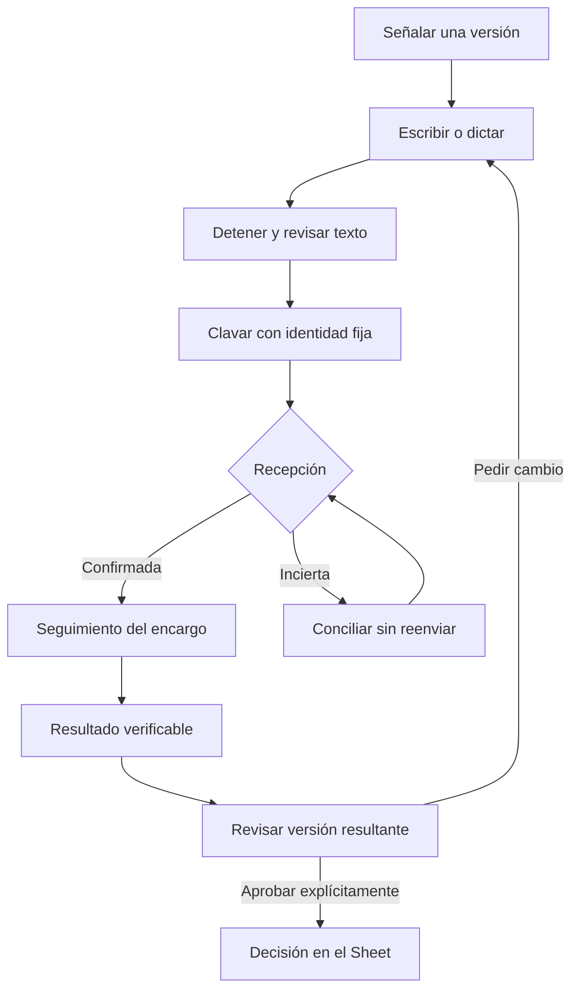

# Punto 4 · correcciones, seguimiento y aprobación

Una corrección conserva lo que señalaste: pieza, propuesta, lámina, versión y toma. Escribir o dictar una nota no aprueba una imagen. Comparar, deslizar o ampliar tampoco decide. La aprobación continúa en el botón explícito del editor y en el registro autenticado de decisiones.

## Interacciones y estados

| Acción o situación | Lo que hace Sala | Lo que acredita |
|---|---|---|
| Señalar y abrir una chinche | Congela contexto antes de mostrar el compositor | Versión a la que se refiere la petición |
| Dictar | Conserva sólo segmentos finales; no guarda audio | Borrador de texto |
| Detener dictado y tocar Clavar | Primero pide revisar; una acción posterior confirma el texto visible | Solicitud revisada por quien la envía |
| Clavar | Conserva ID y sobre en el aparato antes de cualquier envío | Guardado local |
| Respuesta `ok:true` | Marca recibido y conserva recibo local | Recepción del backend, todavía no cumplimiento |
| Respuesta perdida | Conserva estado incierto; consulta la misma identidad y contenido | Sin confirmación todavía; no reenvía a ciegas |
| Sin sesión | Conserva pendiente para la misma identidad | Ningún envío por otra sesión |
| Acceso rechazado | Conserva texto y muestra rechazo | No autorización para producir |
| Issue cerrado sin prueba | Muestra «resultado por verificar» | Cierre administrativo únicamente |
| PR ligado al cierre, integrado, con checks exitosos de su head y publicación de ese merge para Sala | Expone comprobante técnico; confirma CUMPLIDO sólo con acuse del Sheet | Corrección técnica comprobada; no aprobación editorial |
| Aprobar esta toma | Envía la decisión por el circuito de editores vigente | Voto editorial de esa versión |

## Herramientas y fuentes

`chinche.js` del portal captura y revisa el texto; `tablero-sala.js` identifica la lámina/toma visible; `sala-correcciones.js` conserva los sobres y serializa envíos entre pestañas mediante Web Locks. `index.html` comunica su estado y utiliza el backend existente. No almacena credenciales en la nueva cola.

El puente `nube/sala_chinches.py` crea un marcador público mínimo por ID y conserva el contenido en la bandeja privada PRODUCCION. Los nuevos issues no copian autor, nota, captura, URL privada ni contexto de negocio. El seguimiento público incluye sólo referencia técnica. No se borran issues históricos.

La aprobación editorial sigue usando DECISIONES. El backend valida el rol; comparar no vota y un agente no decide. Una nota pendiente no se convierte en aprobación. Si la sesión, propuesta o versión cambia durante la petición de cambio, debe revisarse de nuevo antes de aplicar una decisión.

## Recuperación y límites explícitos

La ausencia de un recibo en las últimas filas del día no demuestra que no se haya escrito. El sobre incierto permanece conservado y se concilia por lectura; si salió de la ventana, requiere consultar su registro original. Las colas antiguas de PRODUCCION no tenían checkpoint: se preservan sin reenviarlas automáticamente. Las decisiones idempotentes conservan su cola anterior.

Un navegador sin Web Locks o con almacenamiento lleno no realiza el POST y muestra que no pudo conservar el envío. Cerrar el navegador puede dejar pendientes locales: no se afirma recepción hasta el acuse. El seguimiento horario existente no garantiza una hora exacta de entrega.

Una corrección de contenido vuelve a las compuertas de revisión de Sala; el comprobante técnico no salta esa revisión. Cierres históricos sin evidencia no se reclasifican como trabajo comprobado. Un PR de otro backend no prueba que Apps Script se haya desplegado; el circuito automático de cumplimiento se limita al frontend de Sala.

## Comprobaciones

Pruebas sintéticas: dictado parcial/final tardío, contexto cambiado, doble clic, recuperación tras perder ACK, ventana vacía, almacenamiento fallido, rechazo, cambio de identidad, recibo distinto, no voto al clavar y gates de cierre. Recorrido Chromium de escritorio/móvil con peticiones de negocio interceptadas. Ninguna prueba usa votos o correcciones reales.

La prueba del micrófono utiliza eventos sintéticos de reconocimiento. La aceptación física del micrófono y la calidad de una corrección real se miden en el punto 5. No se presume capacidad continua de proveedores ni entrega editorial por CI.

Reversión: revertir el PR conservando todos los sobres, IndexedDB, recibos, decisiones, issues y versiones. Nunca borrar un checkpoint incierto para intentar de nuevo.
