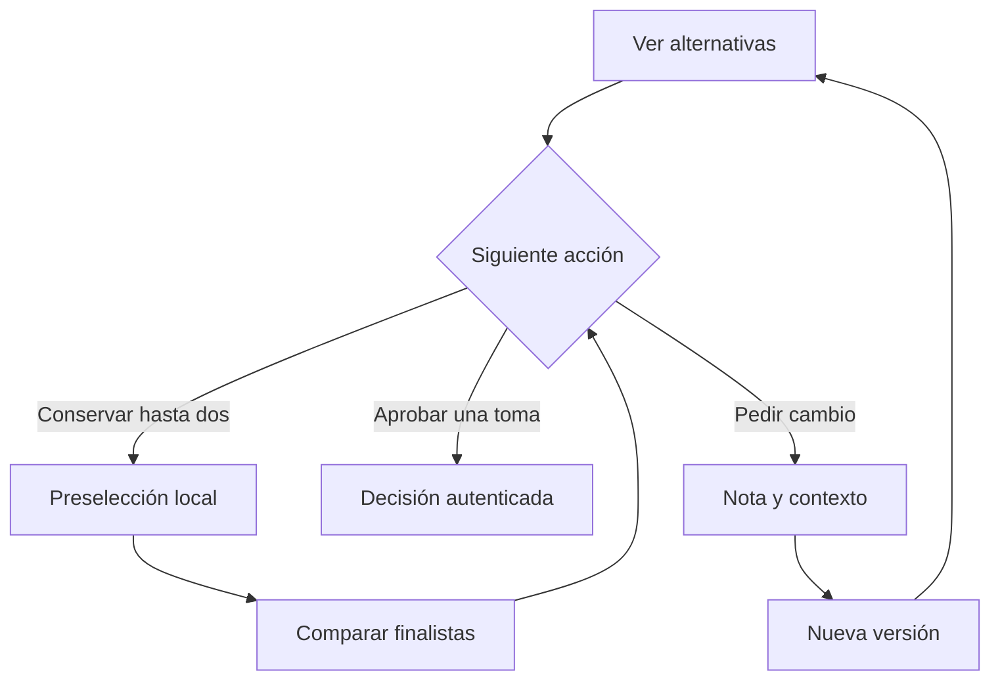

# Punto 5 · evaluación y cierre de interacción

La evaluación distingue funcionamiento técnico, calidad editorial, tiempos y
costo acreditable. Un job exitoso sin trabajo no acredita una pieza nueva; un
resultado marcado hecho tampoco acredita publicación externa o aceptación.

## Interacción completada

El tablero permite conservar hasta dos finalistas de una lámina. El borrador
se guarda en este navegador para el rol, propuesta, lámina, versión, texto y
conjunto exacto de candidatas. Recargar lo conserva; otra versión o editor no
lo hereda. La interfaz declara su alcance local; no promete sincronización.
Falta de almacenamiento o datos inválidos muestra fallo sin anunciar guardado.
Preseleccionar no escribe votos, chinches, PRODUCCION ni llama motores.

Comparar dos finalistas utiliza esas dos tomas. Navegar sigue sin votar.
El panel muestra el texto de la candidata visible, con el texto de lámina sólo
como respaldo. La aprobación explícita conserva el índice original y el flujo
autenticado de decisiones. Elegir varias ideas sigue siendo otra operación.

## Unidades de medición

| Campo | Unidad y límite |
| --- | --- |
| generadas / laminas_preparadas | Láminas con tomas obtenidas en el bucle de preparación; no número de imágenes |
| tomas_obtenidas | Candidatas retornadas por producir_tomas; puede incluir recuperación de recibos, no acredita llamadas nuevas |
| reutilizadas / tiras_reutilizadas | Tiras completas reutilizadas, fuera del bucle anterior |
| cartas | Propuestas listas para montaje; no aprobación ni publicación externa |
| segundos_produccion | Duración registrada por trabajo; no latencia desde petición hasta aceptación |
| costo configurado | Etiqueta de política; no facturación real |

Las funciones invocadas sin conteo de tomas dejan ese dato en null. Los reportes
históricos no se reescriben. Cuotas, motores, crons y Apps Script se conservan.

## Evaluación repetible

1. Fijar versión de código, recibo publicado, propuesta, versión y candidatas.
2. Comparar instrucción, texto visible y escena. Registrar cada discrepancia
   observable sin inferir intención psicológica ni sustituir la opinión del editor.
3. Medir por separado lectura, preparación, proveedor, composición, publicación,
   montaje y espera humana. Una muestra pequeña no define un SLA.
4. Conciliar facturación, solicitudes y unidades sólo si hay evidencia. Costo
   desconocido permanece desconocido; no calcular costo por pieza aceptada si
   faltan importe o aceptación.
5. Clasificar fallos por versión y causa; conservar los históricos. No reactivar
   trabajo viejo sin comprobar vigencia, insumos y autorización actual.
6. Mantener las compuertas de revisión. Ampliar autonomía requiere una decisión
   explícita y casos reales aceptados; esta evaluación no la activa.

El informe privado del punto 5 conserva los casos, tiempos y diagnóstico
observados, junto con sus fuentes. Los datos operativos no se copian al repo.

## Validación y reversión

Pruebas de preselección: recarga, límite de dos, tercera rechazada sin desplazar,
aislamiento por editor/propuesta/lámina/versión/texto/recibo, permisos y fallo
de almacenamiento. Recorrido Chromium móvil/escritorio con endpoints sintéticos:
dos finalistas conservadas tras recarga, texto de la candidata y cero escrituras
de negocio. Mesa: una lámina con dos tomas, cero trabajo y límite parcial.

Revertir el PR sin borrar preselecciones, decisiones, colas, recibos ni imágenes.
La voz física y la aceptación editorial no se sustituyen por eventos sintéticos.
