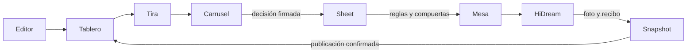

# Sala · Tablero y HiDream

Autorizado por Dirección el13-oct-2026. Esta propuesta precede a la implementación.

Convertir Hoy en tablero por publicaciones con fondos translúcidos, tira completa, zoom por niveles, estados editoriales y producción diferenciados, conteo de intentos e historial y elección de candidatas por carrusel/gestos. Integrar HiDream-I1-Dev gratuito en Mesa/Arranque/Ejecutor, recibos idempotentes y fotografía sin texto incrustado. Preservar sesiones, roles, decisiones, veto de modelos y snapshot privado; ninguna aprobación automática ni respaldo de pago implícito.

El Sheet manda para votos, propuestas, notas y reglas. La tira privada publicada aporta fotos/versiones; el color del tema nunca sustituye el semáforo editorial. Estado verde requiere voto válido; guardar local y guardar en Sheet se indican por separado. Lector/agente sólo leen. Selección viaja como `[toma elegida: índiceOriginal+1]`, sin reindexar al filtrar modelos vetados.

Una columna por publicación vigente; nivel tablero → tira → candidata. Clic/tap acerca; doble clic abre opciones. Botones equivalentes a rueda/pinch/swipe; Escape/Volver conserva elección y scroll. Se muestran todas las láminas, no sólo las reabiertas. Conteo de intentos por identidades/hash, conserva intentos rechazados y no convierte candidatos ausentes en opciones ficticias.

HiDream usa el Space oficial gratuito, modelo fijo, semilla dentro de rango y recibos durables en laminas. Reintento acotado sólo para respuesta exitosa sin archivo; timeout/429 conserva pendiente. El prompt describe acción/objetos, nunca copia el caption entre comillas. El compositor mantiene el texto vigente. No cuota diaria garantizada ni fallback pagado.

Pruebas: python3 nube/verificar.py; git diff --check; regresiones Python y Node existentes. Pruebas aisladas de recibo/cache/hash/seed/rate limit/reintento y rechazo de payloads de HiDream sin credenciales ni red. Playwright con fuentes sintéticas: desktop/móvil/iframe, columnas/tira completa/guion/intención/historial, carrusel, gesto arriba, zoom atrás, selección original y sobre editorial, lector/agente sin votos. Publicación por PR y recibo exacto; comprobación pública de archivos/código y lectura de datos existentes; sin decisiones de prueba en producción.

Reversión: Revertir PR frontend/adaptador y restaurar sólo configuración previa registrada si Dirección lo requiere. No restaurar ni borrar fotos, votos, textos, Sheets, versiones, propuestas, sesiones o snapshots.

Implementación en rama: tablero-sala.js/css e integración del Space oficial. Estado operativo y recibos se completan tras CI/publicación. La política conserva el ID del veto previo para reconocer solicitudes ya marcadas.
