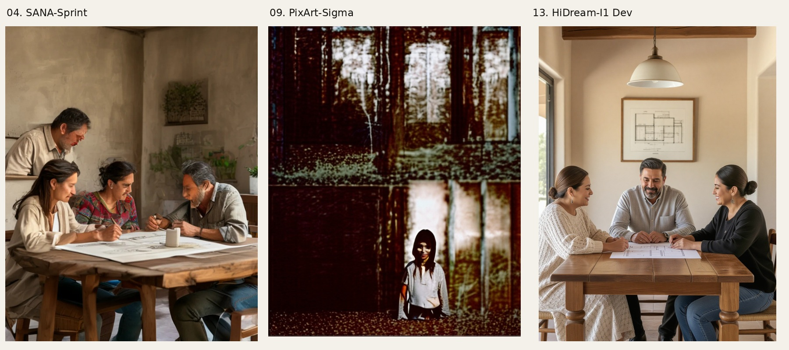
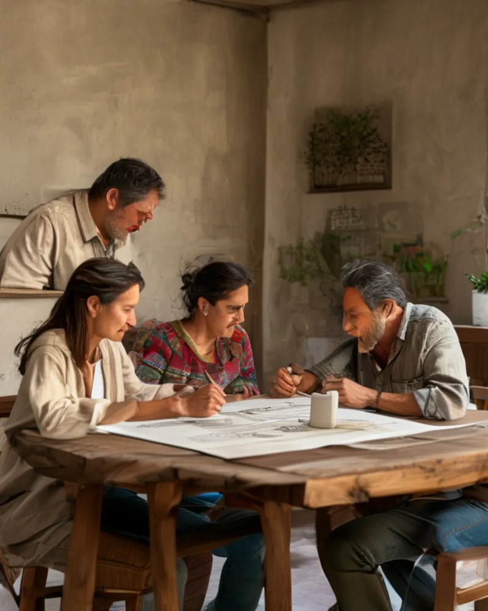

# Prueba real de 15 generadores gratuitos

Mismo encargo: tres adultos mexicanos revisando un plano en una casa. Fotos sintéticas de comparación.
No se han montado en la Sala ni cuentan como decisiones del editor.

[Ejecución y evidencia](https://github.com/yodesarrollomx/sala-edicion/actions/runs/38329443469)

| # | Motor | Resultado | Foto |
|---|---|---|---|
| 1 | Z-Image Turbo | falló la generación | — |
| 2 | Qwen-Image 2.1 | sin cupo | — |
| 3 | Krea 2 Turbo | sin cupo | — |
| 4 | SANA-Sprint | generada | [Abrir original](04-sana-sprint.png) |
| 5 | Ovis-Image 7B | sin cupo | — |
| 6 | Kolors | sin cupo | — |
| 7 | Stable Diffusion 3.5 Large | falló la generación | — |
| 8 | Playground v2.5 | pendiente | — |
| 9 | PixArt-Sigma | pendiente | — |
| 10 | Lucid Origin | sin cupo | — |
| 11 | Phoenix 1.0 | sin cupo | — |
| 12 | Kandinsky 3.1 | pendiente | — |
| 13 | HiDream-I1 Dev | pendiente | — |
| 14 | Ideogram | pendiente | — |
| 15 | Adobe Firefly nativo | pendiente | — |

## Imágenes obtenidas

### 01. Z-Image Turbo

**Estado:** falló la generación

Value: 1024 is not in the list of choices: ['1024x1024 ( 1:1 )', '1152x896 ( 9:7 )', '896x1152 ( 7:9 )', '1152x864 ( 4:3 )', '864x1152 ( 3:4 )', '1248x832 ( 3:2 )', '832x1248 ( 2:3 )', '1280x720 ( 16:9 )', '720x1280 ( 9:16 )', '1344x576 ( 21:9 )', '576x1344 ( 9:21 )', '1280x1280 ( 1:1 )', '1440x1120 ( 9:7 )', '1120x1440 ( 7:9 )', '1472x1104 ( 4:3 )', '1104x1472 ( 3:4 )', '1536x1024 ( 3:2 )', '1024x1536 ( 2:3 )', '1536x864 ( 16:9 )', '864x1536 ( 9:16 )', '1680x720 ( 21:9 )', '720x1680 ( 9:21 )', '1536x1536 ( 1:1 )', '1728x1344 ( 9:7 )', '1344x1728 ( 7:9 )', '1728x1296 ( 4:3 )', '1296x1728 ( 3:4 )', '1872x1248 ( 3:2 )', '1248x1872 ( 2:3 )', '2048x1152 ( 16:9 )', '1152x2048 ( 9:16 )', '2016x864 ( 21:9 )', '864x2016 ( 9:21 )']

### 02. Qwen-Image 2.1

**Estado:** sin cupo

You have exceeded your free ZeroGPU quota (86s requested vs. 78s left). Try again in 3:11:13. Subscribe to Hugging Face PRO to get 40 min of ZeroGPU quota a day - https://huggingface.co/subscribe/pro?from=ZeroGPU

### 03. Krea 2 Turbo

**Estado:** sin cupo

You have exceeded your free ZeroGPU quota (90s requested vs. 33s left). Try again in 3:11:21. Subscribe to Hugging Face PRO to get 40 min of ZeroGPU quota a day - https://huggingface.co/subscribe/pro?from=ZeroGPU

### 04. SANA-Sprint

**Estado:** generada

[Abrir original PNG](04-sana-sprint.png)

### 05. Ovis-Image 7B

**Estado:** sin cupo

You have exceeded your free ZeroGPU quota (112s requested vs. 78s left). Try again in 3:11:06. Subscribe to Hugging Face PRO to get 40 min of ZeroGPU quota a day - https://huggingface.co/subscribe/pro?from=ZeroGPU

### 06. Kolors

**Estado:** sin cupo

'You have exceeded your free ZeroGPU quota (300s requested vs. 82s left). Try again in 3:11:42. Subscribe to Hugging Face PRO to get 40 min of ZeroGPU quota a day - https://huggingface.co/subscribe/pro?from=ZeroGPU'

### 07. Stable Diffusion 3.5 Large

**Estado:** falló la generación

Value 1280 is greater than maximum value 1024.

### 08. Playground v2.5

**Estado:** pendiente

### 09. PixArt-Sigma

**Estado:** pendiente

### 10. Lucid Origin

**Estado:** sin cupo

Cloudflare HTTP 429: {"errors":[{"message":"AiError: AiError: you have used up your daily free allocation of 10,000 neurons, please upgrade to Cloudflare's Workers Paid plan if you would like to continue usage. (7cead4e6-b8c2-4c02-a9d4-3bc9fab04068)","code":4006}],"success":false,"result":{},"messages":[]}

### 11. Phoenix 1.0

**Estado:** sin cupo

Cloudflare HTTP 429: {"errors":[{"message":"AiError: AiError: you have used up your daily free allocation of 10,000 neurons, please upgrade to Cloudflare's Workers Paid plan if you would like to continue usage. (f0d16f66-8c29-45f4-bc36-8ae1ecfa2381)","code":4006}],"success":false,"result":{},"messages":[]}

### 12. Kandinsky 3.1

**Estado:** pendiente

### 13. HiDream-I1 Dev

**Estado:** pendiente

### 14. Ideogram

**Estado:** pendiente

### 15. Adobe Firefly nativo

**Estado:** pendiente

## Encargo común

Photorealistic editorial photograph of a Mexican family of exactly three adults a woman aged 65, a man aged 45 and a woman aged 35, sitting around a wooden dining table and discussing a simple architectural floor plan. Contemporary modest home in Sonora, warm neutral plaster walls, natural window light, authentic everyday clothing, candid interaction, realistic facial proportions and skin texture, anatomically correct hands. Vertical portrait composition, documentary photography, restrained colors, no illustration, no cartoon, no plastic skin, no letters, no captions, no logos, no watermark.
